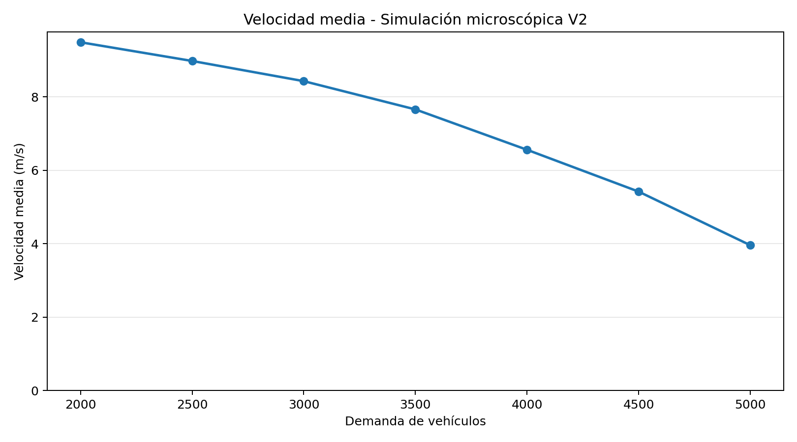
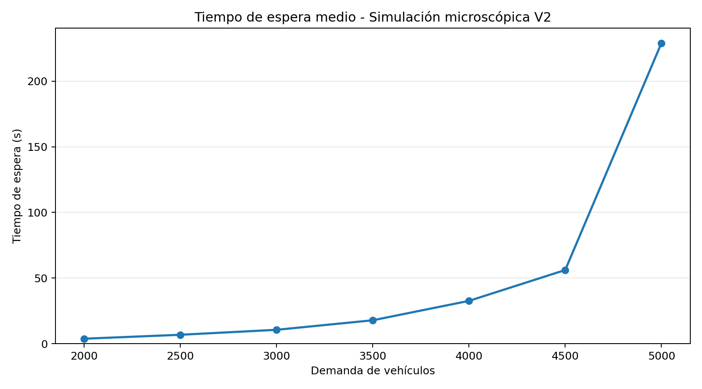
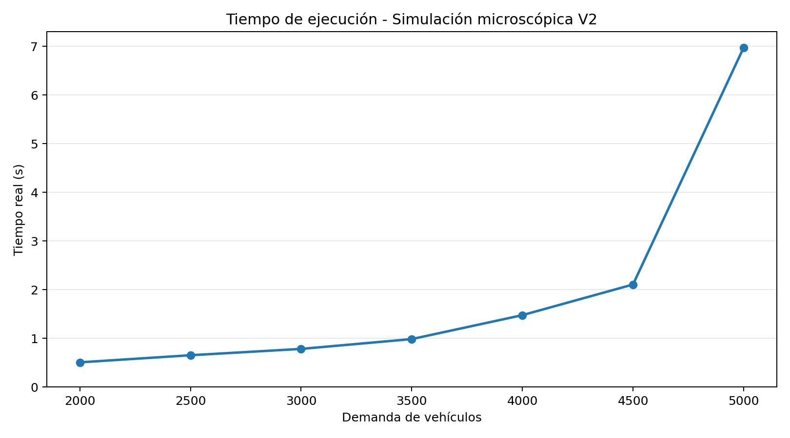
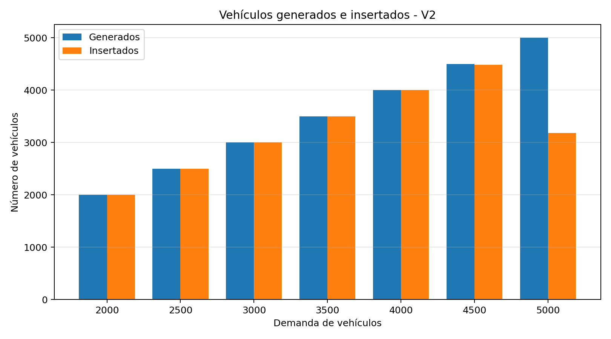

# Mapa sintético V2

En esta segunda versión se ha desarrollado una red de carreteras sintética para realizar simulaciones de tráfico con **SUMO 1.28.0**.

El mapa se genera mediante el script [mapa_sintetico_v2.py](./mapa_sintetico_v2.py), que permite modificar el número de intersecciones y la distancia entre ellas.

Para nuestras pruebas se ha utilizado una red de **5 × 5 intersecciones**.


## 1. Características del mapa

La red presenta las siguientes características:

- **25 intersecciones**, separadas 100 metros.
- **Carreteras bidireccionales**, con un carril por sentido.
- **Velocidad máxima de 13,89 m/s**, aproximadamente 50 km/h.
- **Prioridad por la derecha**, sin semáforos.
- **20 tramos exteriores**, denominados flecos, para permitir la entrada y salida de vehículos.
- **Sin giros en U**.

### Diferencias respecto a V1

La principal diferencia es que ahora las calles permiten circular en ambos sentidos.

También se han introducido algunos cambios:

- **`right_before_left`:** los vehículos deben ceder el paso a los que llegan por su derecha.
- **`keepClear="true"`:** intenta evitar que un vehículo entre en una intersección cuando no tiene espacio suficiente para salir de ella.
- **`fringe="outer"`:** identifica los nodos exteriores de la red.
- **Giros permitidos:** los vehículos pueden continuar recto o girar a izquierda y derecha, pero no realizar giros en U.

## 2. Generación de la red

El mapa se crea ejecutando:

```bash
python3 mapa_sintetico_v2.py -n 5 --longitud 100
```

Donde:

- `-n 5`: establece una red de 5 filas y 5 columnas.
- `--longitud 100`: indica una separación de 100 metros entre intersecciones y en los flecos.

El script crea automáticamente la carpeta `red_5x5`.

### Archivos generados

Antes de construir la red definitiva, Python genera tres archivos:

| Archivo | Contenido |
|---|---|
| `red_5x5.nod.xml` | Posición y configuración de las intersecciones. |
| `red_5x5.edg.xml` | Carreteras, sentidos de circulación, carriles y velocidades. |
| `red_5x5.con.xml` | Conexiones y movimientos permitidos entre las carreteras. |

A partir de estos archivos, **`netconvert`** construye la red definitiva:

`red_5x5.net.xml`

Este es el archivo que posteriormente utiliza SUMO para realizar las simulaciones.

### Configuración de netconvert

El script ejecuta `netconvert` con las siguientes opciones:

```bash
netconvert \
  --node-files red_5x5/red_5x5.nod.xml \
  --edge-files red_5x5/red_5x5.edg.xml \
  --connection-files red_5x5/red_5x5.con.xml \
  --output-file red_5x5/red_5x5.net.xml \
  --no-turnarounds true \
  --no-turnarounds.fringe true \
  --default.junctions.type right_before_left
```

**¿Para qué sirve cada parámetro?**

- **`--node-files`:** carga los nodos creados por Python.
- **`--edge-files`:** carga las carreteras.
- **`--connection-files`:** indica qué movimientos están permitidos.
- **`--output-file`:** guarda la red definitiva.
- **`--no-turnarounds true`:** evita que `netconvert` genere giros en U.
- **`--no-turnarounds.fringe true`:** evita estos giros también en los extremos exteriores de la red.
- **`--default.junctions.type right_before_left`:** establece la prioridad por la derecha como tipo predeterminado de intersección.

Además, el propio script Python evita crear conexiones de giro en U.

**No es necesario ejecutar este comando manualmente**, ya que el generador se encarga de llamar a `netconvert`.

### Visualización del mapa

Para abrir la red en SUMO-GUI:

```bash
sumo-gui -n red_5x5/red_5x5.net.xml
```

## 3. Generación de vehículos

Para generar los viajes utilizamos `randomTrips.py`, una herramienta incluida en SUMO.

En nuestras pruebas, los vehículos comienzan y terminan sus recorridos en los **flecos exteriores**, atravesando la red de carreteras.

Por ejemplo, para generar aproximadamente **5000 vehículos**:

```bash
mkdir -p red_5x5/5000_rutas

python3 /usr/share/sumo/tools/randomTrips.py \
  -n red_5x5/red_5x5.net.xml \
  -b 0 -e 3600 -p 0.72 \
  --random-depart --seed 42 \
  --fringe-factor max --fringe-junctions \
  --min-distance 200 \
  -o red_5x5/5000_rutas/viajes_5000.trips.xml \
  --route-file red_5x5/5000_rutas/rutas_5000.rou.xml
```

### Parámetros utilizados

- **`-n`:** indica la red sobre la que se generan los viajes.
- **`-b 0 -e 3600`:** genera las salidas durante una hora simulada.
- **`-p 0.72`:** establece el intervalo nominal de generación. Cuanto menor sea, más vehículos se generan.
- **`--random-depart`:** distribuye aleatoriamente los instantes de salida.
- **`--seed 42`:** permite reproducir la generación de los viajes.
- **`--fringe-factor max`:** obliga a que el origen y el destino de los vehículos estén en los flecos exteriores de la red.
- **`--fringe-junctions`:** identifica esos flecos utilizando los nodos marcados con `fringe="outer"`.
- **`--min-distance 200`:** establece una distancia mínima de 200 metros entre el origen y el destino.
- **`-o`:** guarda los viajes generados.
- **`--route-file`:** calcula y guarda las rutas que seguirán los vehículos.

Para las simulaciones se han generado distintas cantidades de vehículos, desde **2000 hasta 5000**, modificando principalmente el parámetro `-p`.

En la última prueba se generaron **5001 vehículos**.

## 4. Simulación microscópica

Se han realizado varias simulaciones para estudiar cómo se comporta la red al aumentar la cantidad de vehículos.

Todas las pruebas utilizan la misma red y tienen una duración de **3600 segundos simulados**.

### Comando de ejecución

Ejemplo para 5000 vehículos:

```bash
time sumo \
  -n red_5x5/red_5x5.net.xml \
  -r red_5x5/5000_rutas/rutas_5000.rou.xml \
  --begin 0 --end 3600 \
  --time-to-teleport 300 \
  --duration-log.statistics \
  --statistic-output red_5x5/5000_rutas/micro_5000_stats.xml \
  --log red_5x5/5000_rutas/micro_5000.log
```

Los parámetros principales son:

- **`time sumo`:** mide el tiempo real que tarda el ordenador en ejecutar la simulación.
- **`--begin 0 --end 3600`:** establece la duración de una hora simulada.
- **`--time-to-teleport 300`:** permite teletransportar vehículos en determinadas situaciones de bloqueo o espera prolongada.
- **`--duration-log.statistics`:** muestra las estadísticas generales al finalizar.
- **`--statistic-output`:** guarda las estadísticas en un archivo XML.
- **`--log`:** guarda los mensajes de ejecución.

### Resultados obtenidos

| Vehículos* | Insertados | Velocidad (m/s) | Espera (s) | Teleports | Tiempo real (s) |
|---:|---:|---:|---:|---:|---:|
| 2000 | 2000 | 9,49 | 3,77 | **0** | 0,506 |
| 2500 | 2500 | 8,98 | 6,77 | 0 | 0,652 |
| 3000 | 3001 | 8,43 | 10,56 | 0 | 0,782 |
| 3500 | 3500 | 7,66 | 17,82 | 0 | 0,984 |
| 4000 | 4000 | 6,56 | 32,62 | 0 | 1,476 |
| 4500 | 4481 | 5,42 | 56,11 | 0 | 2,106 |
| **5000** | **3180** | **3,96** | **229,07** | **130** | **6,976** |

*La primera columna indica la cantidad aproximada de vehículos que se pretende generar. El número real puede variar ligeramente.*

**Significado de las columnas:**

- **Insertados:** vehículos que consiguieron incorporarse a la red.
- **Velocidad:** velocidad media registrada para los viajes finalizados.
- **Espera:** tiempo medio que permanecieron detenidos los vehículos que completaron su recorrido.
- **Teleports:** teletransportaciones realizadas por SUMO debido a determinadas esperas o bloqueos prolongados.
- **Tiempo real:** segundos que tardó el ordenador en ejecutar la simulación.

### Observaciones

A medida que aumenta la cantidad de vehículos, disminuye la velocidad media y aumentan los tiempos de espera.

La diferencia más importante aparece entre **4500 y 5000 vehículos**.

Con 4500 vehículos, prácticamente todos consiguen incorporarse a la red y no se producen teletransportaciones.

Sin embargo, con una demanda aproximada de 5000 vehículos:

- Se generan **5001 vehículos**, pero solo **3180** consiguen entrar.
- Quedan **1821 vehículos esperando para incorporarse**.
- La espera media de los viajes finalizados alcanza los **229,07 segundos**.
- Se producen **130 teletransportaciones**: 109 por esperas al ceder el paso (`yield`) y 21 por atascos (`jam`).

Estos resultados muestran que la red alcanza una situación de **saturación severa**.

## 5. Bloqueo circular en las intersecciones

Durante las simulaciones también se observaron situaciones en las que varios vehículos permanecían detenidos en una intersección, esperando a que otro avanzara.

Este problema puede aparecer cuando cuatro vehículos llegan a un cruce con prioridad por la derecha.

### Ejemplo con cuatro vehículos

```text
                  NORTE
                    A
                    ↓
                    |
       OESTE  B →---+---← D  ESTE
                    |
                    ↑
                    C
                   SUR
```

Supongamos que los cuatro vehículos quieren continuar recto y llegan al mismo tiempo.

Según la prioridad por la derecha:

- **A** debe esperar a **B**.
- **B** debe esperar a **C**.
- **C** debe esperar a **D**.
- **D** debe esperar a **A**.

Se forma una dependencia circular:

**A → B → C → D → A**

Ninguno puede avanzar porque todos están esperando a otro. Es el problema conocido como **bloqueo circular** (*circular yielding*).

### ¿Cómo intenta resolverlo SUMO?

SUMO 1.28.0 incorpora un mecanismo para intentar resolver estas situaciones.

Se encuentra en su código fuente:

**[MSVehicle.cpp — SUMO 1.28.0, líneas 2999–3019](https://github.com/eclipse-sumo/sumo/blob/v1_28_0/src/microsim/MSVehicle.cpp#L2999-L3019)**

Su funcionamiento es el siguiente:

1. SUMO comprueba si el vehículo está esperando en una conexión de prioridad equivalente.
2. Busca si existe una cadena circular de vehículos que se bloquean mutuamente.
3. Si detecta esa dependencia, genera un número pseudoaleatorio entre 0 y 1.
4. Según la maniobra del vehículo, decide si retira temporalmente su solicitud de paso.

Para esa última decisión utiliza dos probabilidades:

| Maniobra | Probabilidad de retirar la solicitud |
|---|---:|
| Continuar recto | **25 %** |
| Girar a izquierda o derecha | **75 %** |

Estas probabilidades solo se aplican cuando se cumplen las condiciones del mecanismo de bloqueo circular.

### Ejemplo de funcionamiento

Volvamos a nuestros cuatro vehículos: A, B, C y D.

Supongamos que todos quieren continuar recto y que SUMO detecta una dependencia circular.

**Primero evalúa al vehículo A.**

Como quiere seguir recto, su umbral es `0.25`.

Imaginemos que genera:

```text
Número aleatorio = 0.68

0.68 > 0.25
```

La condición no se cumple, por lo que **A mantiene su solicitud de paso**.

Después, supongamos que SUMO evalúa al vehículo B mientras el bloqueo sigue existiendo.

Ahora genera:

```text
Número aleatorio = 0.12

0.12 < 0.25
```

Esta vez sí se cumple la condición.

Por tanto, **B retira temporalmente su solicitud de paso**.

Esto puede permitir que A deje de estar bloqueado por B y encuentre una oportunidad para avanzar.

Si A consigue atravesar la intersección, pueden empezar a desaparecer las dependencias del resto de vehículos.

**SUMO no selecciona directamente a un ganador.** Evalúa los vehículos individualmente y puede retirar solicitudes cuando detecta una dependencia circular.

Tampoco está obligado a retirar exactamente una solicitud ni garantiza que el bloqueo se resuelva inmediatamente.

Este mecanismo es diferente de `keepClear="true"` y de las teletransportaciones:

- **`keepClear`:** intenta evitar que un vehículo bloquee físicamente una intersección.
- **Bloqueo circular:** SUMO puede retirar temporalmente solicitudes para romper dependencias de prioridad.
- **Teletransportación:** permite resolver determinadas situaciones en las que un

---

## 6. Gráficas de la simulación microscópica

A partir de los resultados anteriores, se han generado cuatro gráficas para observar cómo afecta el aumento de vehículos al funcionamiento de la red.

Las imágenes se han creado con el script [graficas_micro.py](imagenes/graficas_micro.py).

### Velocidad media



La velocidad media disminuye progresivamente al aumentar el tráfico. La reducción es especialmente notable cuando la red comienza a saturarse.

### Tiempo de espera



El tiempo de espera aumenta con la cantidad de vehículos. El cambio más importante se observa entre 4500 y 5000 vehículos, donde la espera media de los viajes finalizados pasa de 56,11 a 229,07 segundos.

### Tiempo de ejecución



El tiempo de ejecución también aumenta al introducir más vehículos. Con 5000 vehículos, SUMO necesita aproximadamente 7 segundos para simular una hora de tráfico.

### Vehículos generados e insertados



Hasta los 4500 vehículos, prácticamente todos consiguen incorporarse a la red.

Sin embargo, en la última prueba se generan 5001 vehículos y solo 3180 consiguen entrar durante la hora simulada. Los otros 1821 permanecen pendientes de incorporarse.

Este resultado, junto con las 130 teletransportaciones registradas, muestra que la red alcanza una situación de saturación severa.


---

## 7. Simulación mesoscópica convencional

En el modelo mesoscópico de SUMO, los vehículos se representan mediante colas dentro de segmentos de carretera, en lugar de calcular continuamente su posición y velocidad como en el microscópico.

Para esta primera prueba utilizamos la misma red V2, las mismas rutas de **5001 vehículos** y una duración de **3600 segundos**.

### 7.1. Comando de ejecución

```bash
time sumo \
  --mesosim true \
  --meso-ltm false \
  --meso-junction-control true \
  --meso-junction-control.limited false \
  --meso-edgelength 50 \
  --meso-jam-threshold -1 \
  --meso-tauff 1.13 \
  --meso-taufj 1.13 \
  --meso-taujf 1.73 \
  --meso-taujj 1.40 \
  --meso-recheck 0 \
  --meso-minor-penalty 0 \
  --time-to-impatience 180 \
  --meso-overtaking false \
  -n red_5x5/red_5x5.net.xml \
  -r red_5x5/5000_rutas/rutas_5000.rou.xml \
  --begin 0 \
  --end 3600 \
  --time-to-teleport 300 \
  --duration-log.statistics \
  --statistic-output red_5x5/5000_rutas/meso_convencional/meso_5000_stats.xml \
  --log red_5x5/5000_rutas/meso_convencional/meso_5000.log
```

### 7.2. Parámetros utilizados

| Parámetro | Valor | ¿Para qué sirve? |
|---|---|---|
| `mesosim` | `true` | Activa la simulación mesoscópica. |
| `meso-ltm` | `false` | Utiliza el modelo convencional en lugar de LTM. |
| `meso-junction-control` | `true` | Comprueba los conflictos de prioridad en los cruces. |
| `meso-junction-control.limited` | `false` | Mantiene el control de prioridades también cuando el segmento de destino está libre. |
| `meso-edgelength` | `50` | Establece la longitud máxima de los segmentos. Las carreteras interiores quedan divididas en dos segmentos. |
| `meso-jam-threshold` | `-1` | Calcula automáticamente el umbral que distingue un segmento libre de uno congestionado. |
| `meso-tauff` | `1.13 s` | Intervalo temporal mínimo para pasar de un segmento libre a otro libre. |
| `meso-taufj` | `1.13 s` | Intervalo temporal mínimo para pasar de un segmento libre a uno congestionado. |
| `meso-taujf` | `1.73 s` | Intervalo temporal mínimo para pasar de un segmento congestionado a otro libre. |
| `meso-taujj` | `1.40 s` | Controla la propagación hacia atrás de los huecos en segmentos congestionados. |
| `meso-recheck` | `0 s` | No añade retrasos fijos al reintentar entrar en un segmento lleno; utiliza los eventos del simulador. |
| `meso-minor-penalty` | `0 s` | No añade tiempo extra al atravesar conexiones sin prioridad. |
| `time-to-impatience` | `180 s` | Tiempo necesario para pasar de impaciencia 0 a 1. Una mayor impaciencia permite aceptar conflictos de prioridad más ajustados. |
| `meso-overtaking` | `false` | Desactiva los adelantamientos mediante intercambios de posición en las colas. |

**Otros parámetros:** `--begin 0 --end 3600` establece una hora de simulación; `--time-to-teleport 300` permite teletransportar vehículos bloqueados según las condiciones de SUMO. Los archivos `.xml` y `.log` guardan las estadísticas y el registro de ejecución.

### 7.3. Resultados: microscópico frente a mesoscópico

Se han utilizado las mismas rutas de 5001 vehículos durante 3600 segundos simulados.

| Métrica | Microscópico | Mesoscópico convencional |
|---|---:|---:|
| Vehículos generados | 5001 | 5001 |
| Vehículos insertados | 3180 | 1213 |
| Vehículos finalizados | 2511 | 653 |
| Vehículos circulando al finalizar | 669 | 560 |
| Vehículos pendientes de entrar | 1821 | 3788 |
| Velocidad media | 3,96 m/s | 3,73 m/s |
| Duración media | 324,65 s | 1176,57 s |
| Tiempo de espera medio | 229,07 s | 330,85 s |
| Tiempo perdido medio | 274,79 s | 1131,31 s |
| Teletransportaciones | 130 | 115 |
| Tiempo real de ejecución | 6,976 s | 0,725 s |

**Observaciones:**

- El mesoscópico fue aproximadamente **9,6 veces más rápido** en esta ejecución.
- El mesoscópico presentó mayor congestión: solamente consiguió insertar 1213 vehículos, frente a 3180 del microscópico.
- Las medias de tiempo corresponden únicamente a los vehículos que finalizaron sus recorridos, por lo que no representan exactamente el mismo conjunto de vehículos.
- Se mantiene esta configuración como referencia para estudiar posteriormente el efecto de modificar los parámetros.

### 7.4. Próximas pruebas

Probar cambios individuales en `meso-jam-threshold`, `meso-taujf` y `time-to-impatience` para observar cómo afectan a la congestión.

Se mantendrán los dos segmentos por carretera y el control completo de prioridades para que la comparación sea coherente con nuestra red V2.

