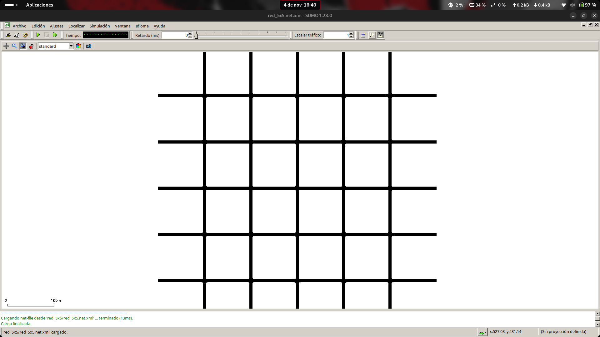

# Mapa sintético V2

En esta segunda versión se ha desarrollado una red de carreteras sintética para realizar simulaciones de tráfico con **SUMO 1.28.0**.

El mapa se genera mediante el script [mapa_sintetico_v2.py](./mapa_sintetico_v2.py), que permite crear una red de tamaño `N × N` y modificar la distancia entre intersecciones.



## 1. Características del mapa

Para las pruebas se ha utilizado una red de **5 × 5 intersecciones**, con las siguientes características:

- **25 intersecciones**, separadas 100 metros.
- **Carreteras bidireccionales**, con un carril por sentido.
- **Velocidad máxima de 50 km/h** aproximadamente.
- **Prioridad por la derecha** (`right_before_left`), sin semáforos.
- **20 tramos exteriores** para permitir la entrada y salida de vehículos.
- **Sin giros en U**.

### Diferencias respecto a V1

La principal diferencia es que ahora todas las calles permiten circular en ambos sentidos.

También se han introducido algunos cambios:

- **`right_before_left`:** los vehículos deben ceder el paso a los que llegan por su derecha.
- **`keepClear="true"`:** intenta evitar que los vehículos entren en una intersección si no tienen espacio suficiente para salir de ella.
- **`fringe="outer"`:** identifica los extremos exteriores de la red, utilizados para generar los viajes.
- **`--no-turnarounds.fringe true`:** evita los giros en U en los extremos exteriores.

### Generación del mapa

Desde la carpeta `MAPA SINTETICO V2`:

```bash
python3 mapa_sintetico_v2.py -n 5 --longitud 100
```

Donde `-n 5` indica las filas y columnas, y `--longitud 100` establece la separación entre intersecciones en metros.

El programa genera automáticamente la carpeta `red_5x5`, que contiene los archivos de la red.

Para visualizarla:

```bash
sumo-gui -n red_5x5/red_5x5.net.xml
```

---

## 2. Generación de vehículos

Para generar los viajes se utiliza `randomTrips.py`, una herramienta incluida en SUMO.

Por ejemplo, para una demanda aproximada de **5000 vehículos**:

```bash
mkdir -p red_5x5/5000_rutas

python3 /usr/share/sumo/tools/randomTrips.py \
  -n red_5x5/red_5x5.net.xml \
  -b 0 -e 3600 -p 0.72 \
  --random-depart --seed 42 \
  --fringe-factor max --fringe-junctions \
  --min-distance 200 \
  -o red_5x5/5000_rutas/viajes_5000.trips.xml \
  --route-file red_5x5/5000_rutas/rutas_5000.rou.xml
```

**Parámetros principales:**

- `-b 0 -e 3600`: genera las salidas durante una hora simulada.
- `-p 0.72`: establece el intervalo nominal entre viajes. Cuanto menor sea, más vehículos se generan.
- `--random-depart`: distribuye aleatoriamente los instantes de salida.
- `--seed 42`: permite reproducir los resultados.
- `--fringe-factor max --fringe-junctions`: favorece los accesos exteriores de la red.
- `--min-distance 200`: establece una distancia mínima de 200 metros entre origen y destino.
- `-o` y `--route-file`: guardan los viajes y sus rutas.

Para generar otras cantidades de vehículos, basta con modificar el valor de `-p` y los nombres de los archivos de salida.

---

## 3. Simulación microscópica

Se han realizado varias pruebas con diferentes cantidades de vehículos para estudiar cómo aumenta la congestión.

Todas las simulaciones tienen una duración de **3600 segundos simulados** y utilizan la misma red.

### Comando de simulación

Ejemplo para 5000 vehículos:

```bash
time sumo \
  -n red_5x5/red_5x5.net.xml \
  -r red_5x5/5000_rutas/rutas_5000.rou.xml \
  --begin 0 --end 3600 \
  --time-to-teleport 300 \
  --duration-log.statistics \
  --statistic-output red_5x5/5000_rutas/micro_5000_stats.xml \
  --log red_5x5/5000_rutas/micro_5000.log
```

Se utiliza `time` para medir el tiempo real que tarda SUMO en ejecutar la simulación.

El parámetro `--time-to-teleport 300` permite teletransportar vehículos cuando se producen determinadas esperas o bloqueos prolongados.

### Resultados

| Vehículos* | Insertados | Velocidad (m/s) | Espera (s) | Teleports | Tiempo real (s) |
|---:|---:|---:|---:|---:|---:|
| 2000 | 2000 | 9,49 | 3,77 | — | 0,506 |
| 2500 | 2500 | 8,98 | 6,77 | 0 | 0,652 |
| 3000 | 3001 | 8,43 | 10,56 | 0 | 0,782 |
| 3500 | 3500 | 7,66 | 17,82 | 0 | 0,984 |
| 4000 | 4000 | 6,56 | 32,62 | 0 | 1,476 |
| 4500 | 4481 | 5,42 | 56,11 | 0 | 2,106 |
| **5000** | **3180** | **3,96** | **229,07** | **130** | **6,976** |

*La primera columna indica la demanda aproximada. El número de vehículos generado puede variar ligeramente. El guion indica un dato no comprobado.*

**Significado de las columnas:**

- **Insertados:** vehículos que consiguieron incorporarse a la red.
- **Velocidad:** velocidad media de los viajes finalizados.
- **Espera:** tiempo medio que permanecieron detenidos los vehículos cuyos viajes finalizaron.
- **Teleports:** vehículos teletransportados por SUMO debido a esperas o bloqueos prolongados.
- **Tiempo real:** segundos que tardó el ordenador en ejecutar la simulación.

### Observaciones

A medida que aumenta la cantidad de vehículos, disminuye la velocidad y aumenta el tiempo de espera.

La diferencia más importante aparece entre **4500 y 5000 vehículos**.

Con 4500 vehículos, prácticamente todos consiguen entrar en la red y no se producen teletransportaciones.

Sin embargo, con una demanda aproximada de 5000 vehículos:

- Se generan **5001 vehículos**, pero solo **3180** consiguen incorporarse.
- Quedan **1821 vehículos esperando para entrar**.
- Se producen **130 teletransportaciones**: 109 por cesión de paso (`yield`) y 21 por atascos (`jam`).

Estos resultados muestran que la red alcanza una situación de **saturación severa**.

---

## 4. Bloqueo circular en las intersecciones

Durante las simulaciones se observaron situaciones en las que varios vehículos permanecían detenidos en una intersección, esperando a que otro avanzara.

Este problema puede aparecer cuando cuatro vehículos llegan a un cruce con prioridad por la derecha.

### Ejemplo con cuatro vehículos

```text
                 NORTE
                   A
                   ↓
                   |
      OESTE  B →---+---← D  ESTE
                   |
                   ↑
                   C
                  SUR
```

Supongamos que los cuatro vehículos quieren seguir recto y llegan al mismo tiempo.

Según la prioridad por la derecha:

- **A** debe esperar a **B**.
- **B** debe esperar a **C**.
- **C** debe esperar a **D**.
- **D** debe esperar a **A**.

Se forma una dependencia circular:

**A → B → C → D → A**

Ninguno puede avanzar porque todos están esperando a otro. Es el problema conocido como *bloqueo circular* o *circular yielding*.

### ¿Cómo intenta resolverlo SUMO?

SUMO 1.28.0 incorpora un mecanismo para intentar romper estas dependencias circulares.

Se encuentra en su código fuente, concretamente en:

**[MSVehicle.cpp — SUMO 1.28.0, líneas 2999–3019](https://github.com/eclipse-sumo/sumo/blob/v1_28_0/src/microsim/MSVehicle.cpp#L2999-L3019)**

Cuando SUMO detecta una dependencia circular durante la evaluación de un vehículo, puede hacer que este **retire temporalmente su solicitud de paso**.

Para decidirlo utiliza un número pseudoaleatorio entre 0 y 1 y lo compara con un umbral:

| Maniobra | Probabilidad de retirar la solicitud |
|---|---:|
| Continuar recto | 25 % |
| Girar a izquierda o derecha | 75 % |

Estas probabilidades solo se aplican cuando se cumplen las condiciones de detección del bloqueo circular.

Por ejemplo, imaginemos que SUMO está evaluando al vehículo **B**, que quiere continuar recto.

Su umbral es `0.25`.

Si SUMO genera el número `0.12`:

```text
0.12 < 0.25
```

Se cumple la condición y **B retira temporalmente su solicitud de paso**.

De esta manera, A puede dejar de estar bloqueado por B y encontrar una oportunidad para avanzar. Si A consigue cruzar, pueden ir desapareciendo las dependencias de los demás vehículos.

**Esto no significa que SUMO seleccione directamente un ganador.** Evalúa cada vehículo individualmente y puede retirar una o varias solicitudes según las condiciones que encuentre.

Tampoco garantiza que la intersección se desbloquee inmediatamente, ya que siguen influyendo los demás conflictos y el espacio disponible.

Este mecanismo permite intentar resolver ciertos bloqueos circulares sin modificar las prioridades de la red.

---
