# Mapa sintético V3

En esta tercera versión se ha modificado la red de carreteras sintética utilizada para realizar simulaciones de tráfico con **SUMO 1.28.0**.

El mapa se genera mediante el script `mapa_sintetico_v3.py`, que permite modificar el número de intersecciones y la longitud de las carreteras.

Para nuestras pruebas se ha utilizado una red de **5 × 5 intersecciones**, con calles de **200 metros**.

El objetivo es estudiar cómo afecta el aumento de vehículos a la congestión de la red y al rendimiento computacional del simulador.

## 1. Características del mapa

La red presenta las siguientes características:

- **25 intersecciones principales**, separadas 200 metros.
- **Carreteras bidireccionales**, con un carril por sentido.
- **Velocidad máxima de 13,89 m/s**, aproximadamente 50 km/h.
- **Prioridad por la derecha**, sin semáforos.
- **20 tramos exteriores**, denominados flecos, para permitir la entrada y salida de vehículos.
- **Sin giros en U**.
- **Sin carriles internos en las intersecciones**.
- Configuración `keepClear="true"` para intentar evitar que los vehículos bloqueen las intersecciones.

La red está formada por **40 tramos interiores bidireccionales y 20 flecos exteriores**. En total, se generan 120 aristas dirigidas.

### Diferencias respecto a V2

Los principales cambios realizados son:

| Característica | V2 | V3 |
|---|---|---|
| Intersecciones | 5 × 5 | 5 × 5 |
| Longitud de calles | 100 m | 200 m |
| Carreteras | Bidireccionales | Bidireccionales |
| Carriles por sentido | 1 | 1 |
| Prioridad | Por la derecha | Por la derecha |
| Carriles internos | Activados | Desactivados |
| Origen y destino | Flecos exteriores | Aleatorios por la red |
| Distancia mínima utilizada | 200 m | Sin mínimo adicional |

**¿Por qué se han realizado estos cambios?**

En primer lugar, al aumentar la longitud de las calles de 100 a 200 metros, existe más espacio entre intersecciones para almacenar vehículos.

En segundo lugar, se han eliminado los carriles internos mediante `--no-internal-links true`.

Esto simplifica la representación del desplazamiento dentro de los cruces, aunque **los vehículos siguen respetando las reglas de prioridad**.

Por último, se ha modificado la generación de los viajes. En lugar de obligar a los vehículos a comenzar y terminar en los flecos, ahora sus orígenes y destinos se seleccionan aleatoriamente entre las carreteras de la red.

---

## 2. Generación de la red

El mapa se crea ejecutando:

```bash
python3 mapa_sintetico_v3.py -n 5 --longitud 200 --semilla 42
```

Donde:

- **`-n 5`:** establece una red de 5 filas y 5 columnas.
- **`--longitud 200`:** indica una separación de 200 metros entre intersecciones y en los flecos.
- **`--semilla 42`:** permite reproducir la generación de la red.

El script crea automáticamente la carpeta `red_5x5`.

### Archivos generados

Antes de construir la red definitiva, Python genera tres archivos:

| Archivo | Contenido |
|---|---|
| `red_5x5.nod.xml` | Posición y configuración de las intersecciones. |
| `red_5x5.edg.xml` | Carreteras, sentidos de circulación, carriles y velocidades. |
| `red_5x5.con.xml` | Conexiones y movimientos permitidos. |

A partir de estos archivos, **`netconvert`** construye la red definitiva:

`red_5x5.net.xml`

Este archivo es el que posteriormente utiliza SUMO para realizar las simulaciones.

### Configuración de netconvert

Las opciones principales utilizadas son:

```bash
netconvert \
  --node-files red_5x5/red_5x5.nod.xml \
  --edge-files red_5x5/red_5x5.edg.xml \
  --connection-files red_5x5/red_5x5.con.xml \
  --output-file red_5x5/red_5x5.net.xml \
  --no-turnarounds true \
  --no-turnarounds.fringe true \
  --default.junctions.type right_before_left \
  --no-internal-links true
```

**¿Para qué sirve cada parámetro?**

- **`--node-files`:** carga los nodos creados por Python.
- **`--edge-files`:** carga las carreteras.
- **`--connection-files`:** indica qué movimientos están permitidos.
- **`--output-file`:** guarda la red definitiva.
- **`--no-turnarounds true`:** evita que se generen giros en U.
- **`--no-turnarounds.fringe true`:** evita estos giros también en los extremos exteriores.
- **`--default.junctions.type right_before_left`:** establece la prioridad por la derecha.
- **`--no-internal-links true`:** elimina los carriles internos de las intersecciones.

**No es necesario ejecutar manualmente este comando**, ya que el generador se encarga de construir la red.

### Visualización del mapa

Para abrir la red en SUMO-GUI:

```bash
sumo-gui -n red_5x5/red_5x5.net.xml
```

---

## 3. Generación de vehículos

Para generar los viajes utilizamos `randomTrips.py`, una herramienta incluida en SUMO.

En esta versión los vehículos pueden comenzar y terminar sus recorridos en diferentes carreteras de la red, sin obligarlos a utilizar los flecos exteriores.

Por ejemplo, para generar aproximadamente **5000 vehículos**:

```bash
mkdir -p red_5x5/5000_rutas/micro

python3 /usr/share/sumo/tools/randomTrips.py \
  -n red_5x5/red_5x5.net.xml \
  -b 0 \
  -e 3600 \
  -p 0.72 \
  --random-depart \
  --seed 42 \
  -o red_5x5/5000_rutas/trips_5000.trips.xml \
  -r red_5x5/5000_rutas/rutas_5000.rou.xml
```

### Parámetros utilizados

- **`-n`:** indica la red sobre la que se generan los viajes.
- **`-b 0 -e 3600`:** genera las salidas durante una hora simulada.
- **`-p 0.72`:** establece el periodo nominal de generación. Cuanto menor sea, más vehículos se generan.
- **`--random-depart`:** distribuye aleatoriamente los instantes de salida.
- **`--seed 42`:** permite reproducir la generación.
- **`-o`:** guarda los viajes generados.
- **`-r`:** calcula y guarda las rutas que seguirán los vehículos.

**Importante:** en la configuración definitiva no utilizamos `--min-distance 500`, `--fringe-junctions` ni `--fringe-factor max`.

Inicialmente se realizaron algunas pruebas con una distancia mínima de 500 metros, pero se descartaron para la comparación principal porque modificaban considerablemente los recorridos y la congestión observada.

### Cantidades generadas

Se han realizado seis pruebas, modificando principalmente el parámetro `-p`:

| Vehículos aproximados | Parámetro `-p` | Vehículos cargados |
|---|---:|---:|
| 3000 | 1.2 | 3001 |
| 3500 | 1.02857143 | 3500 |
| 4000 | 0.9 | 4000 |
| 4500 | 0.8 | 4500 |
| 5000 | 0.72 | 5001 |
| 5500 | 0.65454545 | 5501 |

El número real de vehículos puede variar ligeramente respecto a la cantidad nominal.

---

## 4. Simulación microscópica

Se han realizado seis simulaciones microscópicas para estudiar cómo cambia el comportamiento de la red al aumentar la cantidad de vehículos.

Todas las pruebas utilizan la misma red y tienen una duración de **3600 segundos simulados**.

Para cada cantidad de vehículos se realizan dos ejecuciones:

- **Simulación completa:** muestra estadísticas, advertencias y guarda los resultados.
- **Simulación limpia:** reduce la información mostrada por pantalla para medir el tiempo real de ejecución.

### 4.1. Simulación completa

Ejemplo para 5000 vehículos:

```bash
{ time sumo \
  -n red_5x5/red_5x5.net.xml \
  -r red_5x5/5000_rutas/rutas_5000.rou.xml \
  --begin 0 \
  --end 3600 \
  --time-to-teleport 300 \
  --duration-log.statistics true \
  --statistic-output red_5x5/5000_rutas/micro/stats.xml \
  --verbose true; } 2>&1 | tee red_5x5/5000_rutas/micro/micro_completo.log
```

**Parámetros utilizados:**

- **`time sumo`:** mide el tiempo real que tarda el ordenador en ejecutar la simulación.
- **`-n`:** indica la red utilizada.
- **`-r`:** carga las rutas generadas.
- **`--begin 0 --end 3600`:** establece una hora de simulación.
- **`--time-to-teleport 300`:** permite teletransportar vehículos en determinadas situaciones de espera prolongada.
- **`--duration-log.statistics true`:** muestra las estadísticas generales al finalizar.
- **`--statistic-output`:** guarda las estadísticas en un archivo XML.
- **`--verbose true`:** muestra información detallada.
- **`tee`:** guarda en un archivo el contenido mostrado por la terminal.

### 4.2. Simulación limpia

Para obtener una medición del tiempo real con menos salida por terminal:

```bash
time sumo \
  -n red_5x5/red_5x5.net.xml \
  -r red_5x5/5000_rutas/rutas_5000.rou.xml \
  --begin 0 \
  --end 3600 \
  --time-to-teleport 300 \
  --verbose false \
  --no-warnings true \
  --no-step-log true
```

**Parámetros adicionales:**

- **`--verbose false`:** desactiva la información detallada.
- **`--no-warnings true`:** evita mostrar las advertencias.
- **`--no-step-log true`:** elimina el registro del progreso de la simulación.

Estas opciones no modifican las reglas de tráfico ni desactivan los teletransportes.

En ambas ejecuciones utilizamos el valor **`real`** proporcionado por el comando `time` de Linux.

---

### 4.3. Resultados: vehículos cargados, insertados y finalizados

| Vehículos | Cargados | Insertados | Finalizados | Circulando | Pendientes de entrar |
|---:|---:|---:|---:|---:|---:|
| 3000 | 3001 | 2992 | 2897 | 95 | 9 |
| 3500 | 3500 | 3486 | 3368 | 118 | 14 |
| 4000 | 4000 | 3969 | 3792 | 177 | 31 |
| 4500 | 4500 | 4379 | 4124 | 255 | 121 |
| **5000** | **5001** | **3698** | **2684** | **1014** | **1303** |
| **5500** | **5501** | **3986** | **2888** | **1098** | **1515** |

**Significado de las columnas:**

- **Cargados (`Loaded`):** vehículos cargados desde el archivo de rutas.
- **Insertados (`Inserted`):** vehículos que consiguieron incorporarse a la red.
- **Finalizados:** vehículos que completaron su recorrido antes de terminar la simulación.
- **Circulando (`Running`):** vehículos que todavía estaban dentro de la red al llegar al segundo 3600.
- **Pendientes (`Waiting`):** vehículos que tenían prevista su salida, pero todavía no habían podido incorporarse a la red.

Se observa que, con 5000 y 5500 vehículos, aumenta considerablemente la cantidad de vehículos pendientes de entrar.

---

### 4.4. Resultados: velocidad, duración y tiempos medios

| Vehículos | Recorrido (m) | Velocidad (m/s) | Duración (s) | Detenido (s) | Tiempo perdido (s) | Retraso incorporación (s) |
|---:|---:|---:|---:|---:|---:|---:|
| 3000 | 1102,87 | 10,81 | 105,98 | 9,77 | 25,57 | 4,03 |
| 3500 | 1099,53 | 10,04 | 117,03 | 17,29 | 36,88 | 6,64 |
| 4000 | 1106,50 | 9,00 | 138,14 | 31,07 | 57,44 | 13,44 |
| 4500 | 1097,62 | 7,87 | 173,00 | 56,62 | 92,71 | 34,05 |
| **5000** | **1096,76** | **7,25** | **248,06** | **127,11** | **165,64** | **32,58** |
| **5500** | **1088,74** | **6,71** | **262,23** | **134,09** | **179,94** | **60,07** |

**Significado de las columnas:**

- **Recorrido (`RouteLength`):** longitud media de las rutas que han completado los vehículos.
- **Velocidad (`Speed`):** velocidad media registrada para los viajes finalizados.
- **Duración (`Duration`):** tiempo medio desde que un vehículo se incorpora a la red hasta que llega a su destino.
- **Detenido (`WaitingTime`):** tiempo medio que los vehículos permanecieron prácticamente parados por circunstancias del tráfico.
- **Tiempo perdido (`TimeLoss`):** tiempo adicional empleado respecto a circular sin demoras a la velocidad deseada.
- **Retraso de incorporación (`DepartDelay`):** diferencia entre el instante en que un vehículo tenía programada su salida y el momento en que consiguió incorporarse realmente a la red.

**Importante:** estas medias corresponden a los vehículos que finalizaron sus recorridos. No incluyen los tiempos de los vehículos que continuaban circulando o estaban pendientes de entrar al finalizar la simulación.

Además, `DepartDelay` no representa el instante exacto de incorporación de cada vehículo, sino el **retraso medio respecto a su salida programada**.

### Observaciones

A medida que aumenta la cantidad de vehículos:

- La velocidad media disminuye progresivamente.
- Aumenta el tiempo necesario para completar los recorridos.
- Los vehículos permanecen más tiempo detenidos.
- Aumenta el tiempo perdido respecto a una circulación sin demoras.

El cambio más importante aparece entre **4500 y 5000 vehículos**.

Con 4500 vehículos, el tiempo detenido medio es de 56,62 segundos.

Con 5000 vehículos, aumenta hasta 127,11 segundos.

También se observa que el retraso de incorporación llega a **60,07 segundos con 5500 vehículos**, aunque la media corresponde únicamente a los viajes finalizados.

---

### 4.5. Resultados: teletransportes y frenadas de emergencia

| Vehículos | Teleports `yield` | Teleports `jam` | Total teleports | Frenadas de emergencia |
|---:|---:|---:|---:|---:|
| 3000 | 0 | 0 | 0 | 1 |
| 3500 | 0 | 0 | 0 | 1 |
| 4000 | 0 | 0 | 0 | 0 |
| 4500 | 0 | 0 | 0 | 1 |
| **5000** | **92** | **4** | **96** | **0** |
| **5500** | **110** | **12** | **122** | **1** |

**Significado de las columnas:**

- **`yield`:** teletransporte asociado a una espera prolongada al ceder el paso.
- **`jam`:** teletransporte asociado a una situación de atasco.
- **Total teleports:** número total de teletransportes registrados durante la simulación.
- **Frenadas de emergencia (`Emergency Braking`):** número de eventos en los que un vehículo necesitó desacelerar más bruscamente de lo deseado.

Una frenada de emergencia no implica necesariamente que se haya producido una colisión.

En las simulaciones de 3000 a 4500 vehículos no se registraron teletransportes.

Sin embargo, con 5000 vehículos aparecieron 96 teletransportes y con 5500 aumentaron hasta 122.

---

### 4.6. Resultados: tiempos reales de ejecución

Se han registrado los tiempos de ambas ejecuciones utilizando el comando `time` de Linux.

| Vehículos | Tiempo real completo (s) | Tiempo real limpio (s) |
|---:|---:|---:|
| 3000 | 0,674 | 0,673 |
| 3500 | 0,855 | 0,834 |
| 4000 | 1,152 | 1,099 |
| 4500 | 1,621 | 1,563 |
| **5000** | **5,330** | **4,339** |
| **5500** | **5,966** | **5,216** |

**Diferencia entre ambos tiempos:**

- **Tiempo completo:** corresponde a la ejecución con estadísticas y advertencias mostradas por pantalla.
- **Tiempo limpio:** corresponde a la ejecución con menos información mostrada y se utiliza como referencia principal para comparar el rendimiento computacional.

Ambos tiempos representan segundos reales de ejecución, no los 3600 segundos simulados.

Se observa que el tiempo de ejecución aumenta progresivamente con la cantidad de vehículos, especialmente a partir de 5000.

---

## Calibración de los parámetros mesoscópicos

Para aproximar los resultados del modelo mesoscópico a los del microscópico, se investigaron diferentes parámetros de SUMO que permiten modificar el comportamiento del tráfico.

El objetivo era conseguir resultados similares en velocidad, tiempo perdido y congestión, manteniendo un tiempo de ejecución inferior al del modelo microscópico.

### 1. Investigación sobre las penalizaciones

En el artículo *Towards automated calibration of large-scale traffic simulations*, Mahajan et al. (2023) estudiaron la calibración de simulaciones de tráfico en Múnich utilizando SUMO.

En el apartado 6.4, los investigadores identificaron `meso-minor-penalty` como uno de los parámetros que influían significativamente en los resultados.

Observaron que las penalizaciones inferiores a 10 segundos ofrecían buenos ajustes en su escenario. Aunque la configuración final del estudio utilizó una penalización de 0 segundos, estos resultados muestran que es un parámetro interesante para calibrar.

A partir de esta investigación, decidimos estudiar el uso de penalizaciones para representar de manera simplificada los retrasos en las intersecciones.

El parámetro utilizado fue:

```bash
--meso-minor-penalty 4
```

Esta opción introduce una penalización temporal de 4 segundos en determinados movimientos sin prioridad.

También se decidió mantener activado el control limitado de intersecciones:

```bash
--meso-junction-control true
--meso-junction-control.limited true
```

De esta forma, cuando el segmento de destino no está congestionado, SUMO puede utilizar las penalizaciones en los movimientos sin prioridad.

Cuando el segmento de destino está congestionado, interviene el control simplificado de prioridades y no se aplica la penalización fija en esa conexión.

Así se buscó combinar una representación simplificada de los retrasos con el control de prioridades en situaciones de congestión.

### 2. Influencia del parámetro `meso-tauff`

Posteriormente, se estudió el artículo *Revisiting mesoscopic traffic flow simulation in SUMO: Limitations, analysis, and an alternative*, de Ni et al. (2026).

En el apartado 2, los investigadores explican el funcionamiento del modelo mesoscópico convencional de Eissfeldt, utilizado por SUMO.

Este modelo divide las carreteras en segmentos que pueden encontrarse en dos estados: libres (*free*) o congestionados (*jammed*).

Para regular la transferencia de vehículos entre segmentos, utiliza diferentes parámetros temporales.

Uno de ellos es `meso-tauff`, que establece la separación temporal mínima neta entre vehículos consecutivos cuando pasan de un segmento libre a otro segmento libre.

Su valor predeterminado en SUMO es de **1,13 segundos**.

Los investigadores relacionan este parámetro con la capacidad máxima de circulación mediante la expresión:

\[
\tau_{ff}=\frac{1}{q_{\max}}
\]

Donde:

- **τff:** separación temporal mínima entre vehículos en condiciones de flujo libre.
- **qmax:** flujo máximo de vehículos por segundo asociado a dicha separación.

Esto significa que `tauff` influye directamente en el flujo de vehículos:

- **Un valor menor de `tauff`** permite transferencias más frecuentes entre segmentos libres, aumentando la capacidad de circulación.
- **Un valor mayor de `tauff`** aumenta la separación temporal y reduce la capacidad de transferencia, pudiendo favorecer la acumulación de vehículos y la formación de congestión.

Por ejemplo, al aumentar `tauff` de 1,13 a 6 segundos, se limita considerablemente el ritmo al que los vehículos pueden pasar entre segmentos libres.

Esto no significa que cada vehículo tenga que detenerse exactamente 6 segundos, sino que SUMO utiliza esa separación temporal neta para regular las transferencias. El intervalo efectivo también depende de la longitud de los vehículos y de las demás restricciones de circulación.

**Por tanto, podemos utilizar `tauff` como un parámetro de calibración del flujo de tráfico**, modificando la capacidad de transferencia para intentar aproximar la congestión y los tiempos perdidos de MESO a los observados en MICRO.

Esta relación entre separación temporal y flujo se explica en el apartado 2 del artículo de Ni et al. (2026), mientras que su implementación concreta se describe en la documentación oficial de SUMO.

### 3. Primera prueba: influencia de `tauff`

Se desarrolló un script Python para ejecutar automáticamente diferentes simulaciones, manteniendo una penalización de 4 segundos y el control limitado activado.

Se utilizaron los siguientes valores:

```python
TAUFF = [1.13, 3.0, 4.0, 4.5, 5.0, 5.5, 6.0]
PENALTY = 4
```

El objetivo principal era observar cómo cambiaba el `TimeLoss` al aumentar `tauff`, manteniendo constantes los demás parámetros.

**Resultados del TimeLoss medio (segundos):**

| tauff | 3500 | 4000 | 4500 | 5000 | 5500 |
|---|---:|---:|---:|---:|---:|
| 1,13 | 15,11 | 15,62 | 15,92 | 16,23 | 16,56 |
| 3,00 | 17,44 | 18,61 | 19,66 | 21,16 | 22,52 |
| 4,00 | 18,98 | 23,15 | 29,54 | 49,04 | 102,34 |
| 4,50 | 22,07 | 26,49 | 36,66 | 82,97 | 125,65 |
| 5,00 | 24,61 | 31,87 | 45,82 | 146,78 | 174,34 |
| 5,50 | 28,03 | 36,66 | 55,56 | 144,60 | 182,95 |
| **6,00** | **32,59** | **44,72** | **82,49** | **178,04** | **212,82** |
| **MICRO** | **36,88** | **57,44** | **92,71** | **165,64** | **179,94** |

Los resultados muestran que los valores bajos de `tauff` producen tiempos perdidos considerablemente inferiores a MICRO.

Al aumentar `tauff`, los tiempos perdidos crecen y aparecen situaciones de congestión más intensas.

Con `tauff = 6`, los valores obtenidos se aproximan bastante a MICRO en varios escenarios, especialmente entre 3500 y 4500 vehículos.

Sin embargo, con 5000 y 5500 vehículos aparecen más bloqueos y teletransportes, por lo que también es necesario considerar esas estadísticas.

Esta prueba permitió comprobar experimentalmente cómo la modificación de `tauff` influye en el flujo y la congestión de nuestra red.

### 4. Segunda prueba: combinación de `tauff` y penalizaciones

Después de estudiar la influencia de `tauff`, se realizó una búsqueda de combinaciones con diferentes penalizaciones.

Se probaron:

- `tauff`: desde 4 hasta 7 segundos, en incrementos de 0,25.
- Penalizaciones: desde 3 hasta 12 segundos.

En total se evaluaron **130 combinaciones**, utilizando las seis demandas de vehículos.

El intervalo de penalizaciones se amplió más allá de los 10 segundos para observar también qué ocurría con valores superiores a los estudiados en Múnich.

Para seleccionar la configuración se utilizó un índice de error respecto a los resultados microscópicos, considerando las diferencias de comportamiento entre ambos modelos.

**Configuraciones con menor error en esta búsqueda:**

| Posición | Penalización | tauff | Índice de error |
|---|---:|---:|---:|
| **1** | **4 s** | **6,00 s** | **0,1232** |
| 2 | 5 s | 6,75 s | 0,1297 |
| 3 | 5 s | 6,00 s | 0,1368 |
| 4 | 8 s | 5,25 s | 0,1388 |
| 5 | 3 s | 6,00 s | 0,1445 |

La combinación con menor índice de error fue:

```bash
--meso-tauff 6.00
--meso-minor-penalty 4
```

Esta combinación se seleccionó como configuración de referencia para las simulaciones mesoscópicas posteriores.

La elección procede de los resultados de nuestra propia calibración y no de una recomendación directa de los artículos científicos.

El índice de error corresponde al criterio de comparación utilizado en el script de búsqueda. Para reproducir exactamente la clasificación, debe conservarse también la fórmula de cálculo de dicho índice.

### 5. Configuración mesoscópica seleccionada

La configuración utilizada en las simulaciones definitivas fue:

```bash
--mesosim true
--meso-ltm false
--meso-junction-control true
--meso-junction-control.limited true
--meso-minor-penalty 4
--meso-tauff 6.00
--meso-taufj 1.13
--meso-taujf 1.73
--meso-taujj 1.40
--meso-edgelength 98
--meso-jam-threshold -1
--meso-recheck 0
--meso-overtaking false
--begin 0
--end 3600
--time-to-teleport 300
```

Esta configuración combina las penalizaciones temporales, la separación entre vehículos y el control limitado de intersecciones.

El objetivo es aproximar las estadísticas microscópicas, aunque esto no implica reproducir exactamente el comportamiento individual de los vehículos ni todos los conflictos de prioridad.

### 6. Comparación de resultados MICRO y MESO

Una vez seleccionada la configuración, se ejecutaron las simulaciones mesoscópicas con las mismas rutas utilizadas en MICRO.

Las siguientes tablas recogen los resultados obtenidos.

**Comparación general de las simulaciones:**

| Vehículos | Modelo | Finalizados | Velocidad (m/s) | Duración (s) | WaitingTime (s) | TimeLoss (s) | Teleports | Pendientes |
|---|---|---:|---:|---:|---:|---:|---:|---:|
| 3000 | MICRO | 2897 | 10,81 | 105,98 | 9,77 | 25,57 | 0 | 9 |
| 3000 | MESO | 2895 | 10,68 | 106,32 | 4,97 | 25,52 | 0 | 0 |
| 3500 | MICRO | 3368 | 10,04 | 117,03 | 17,29 | 36,88 | 0 | 14 |
| 3500 | MESO | 3388 | 10,11 | 113,17 | 6,76 | 32,59 | 0 | 0 |
| 4000 | MICRO | 3792 | 9,00 | 138,14 | 31,07 | 57,44 | 0 | 31 |
| 4000 | MESO | 3867 | 9,39 | 125,93 | 8,79 | 44,72 | 0 | 1 |
| 4500 | MICRO | 4124 | 7,87 | 173,00 | 56,62 | 92,71 | 0 | 121 |
| 4500 | MESO | 4022 | 8,07 | 163,04 | 12,22 | 82,49 | 0 | 12 |
| 5000 | MICRO | 2684 | 7,25 | 248,06 | 127,11 | 165,64 | 96 | 1303 |
| 5000 | MESO | 2276 | 6,90 | 256,73 | 26,77 | 178,04 | 174 | 739 |
| 5500 | MICRO | 2888 | 6,71 | 262,23 | 134,09 | 179,94 | 122 | 1515 |
| 5500 | MESO | 2045 | 6,53 | 290,05 | 31,72 | 212,82 | 242 | 1165 |

Las estadísticas de velocidad, duración, tiempo de espera y tiempo perdido corresponden a los vehículos que finalizaron su recorrido.

**Tiempos reales de ejecución:**

| Vehículos | MICRO (s) | MESO (s) |
|---|---:|---:|
| 3000 | 0,734 | 0,203 |
| 3500 | 0,932 | 0,231 |
| 4000 | 1,194 | 0,254 |
| 4500 | 1,684 | 0,280 |
| 5000 | 5,259 | 1,286 |
| 5500 | 6,164 | 2,158 |

Los tiempos proceden de ejecuciones individuales realizadas durante las pruebas. Los tiempos MICRO pertenecen a mediciones anteriores y los tiempos MESO a la ejecución definitiva, por lo que no representan una comparación de promedios obtenidos en una misma sesión.

### 7. Conclusión

Las pruebas muestran que modificar `tauff` permite regular el flujo de vehículos y aproximar los niveles de congestión de MESO a los observados en MICRO.

Mediante la calibración conjunta de `tauff` y las penalizaciones se seleccionó la configuración **6/4**, que consigue resultados similares en velocidad y tiempo perdido en varios escenarios, aunque presenta diferencias en los tiempos de espera y los bloqueos.

En general, **MESO permite reproducir parte del comportamiento microscópico con un tiempo de ejecución considerablemente menor**, aunque con una representación más simplificada del tráfico.

### Referencias

**[1]** Mahajan, V., Cantelmo, G. y Antoniou, C. (2023). *Towards automated calibration of large-scale traffic simulations*. Apartado 6.4: Scenario 3, Munich scenario with SUMO and real-world data. Repositorio mediaTUM, documento 1701188.

**[2]** Ni, Y.-C., Akopian, A., Kouvelas, A. y Makridis, M. A. (2026). *Revisiting mesoscopic traffic flow simulation in SUMO: Limitations, analysis, and an alternative*. SUMO Conference 2026. Apartado 2: Recap of Eissfeldt's queue dynamics. arXiv:2606.09282.

**[3]** Eclipse SUMO Documentation (2026). *Mesoscopic Simulation (Meso)*. Apartados Longitudinal Model, Junction Model y Penalty at uncontrolled intersections.

---

---

## Gráficas de comparación MICRO–MESO

A partir de los resultados anteriores se han generado gráficas para comparar el modelo microscópico con la configuración mesoscópica seleccionada (`tauff = 6` y penalización de 4 segundos).

Las imágenes se han creado mediante el script [graficas_comparacion.py](graficas_comparacion.py) y se encuentran en la carpeta `imagenes/comparacion_micro_meso/`.

### Velocidad media

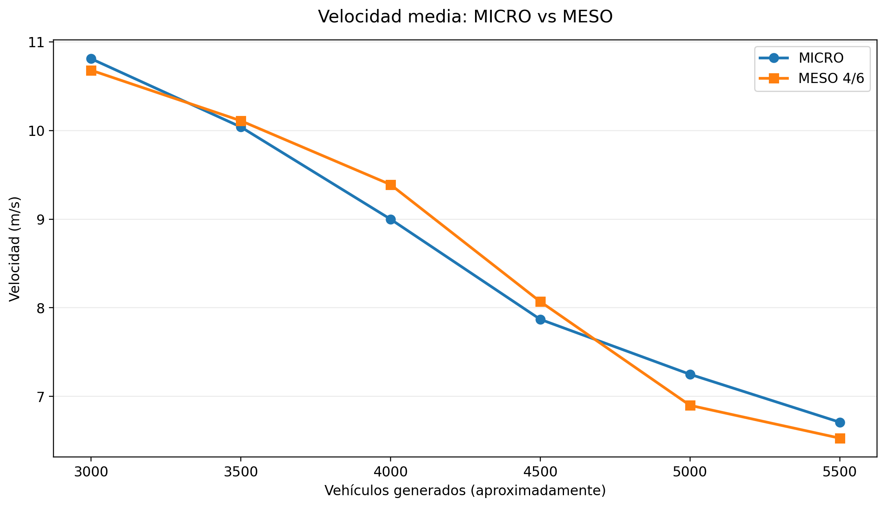

La velocidad disminuye al aumentar la cantidad de vehículos. Ambos modelos presentan una evolución parecida, aunque no coinciden exactamente en todos los escenarios.

### Tiempo perdido (TimeLoss)

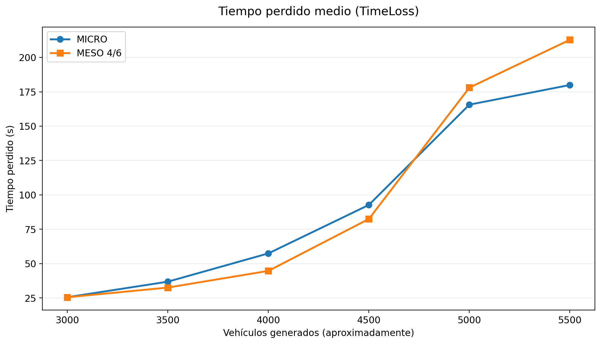

El tiempo perdido aumenta con la congestión. MESO obtiene valores próximos a MICRO en varios escenarios, pero presenta diferencias con 5000 y 5500 vehículos.

### Tiempo de espera (WaitingTime)

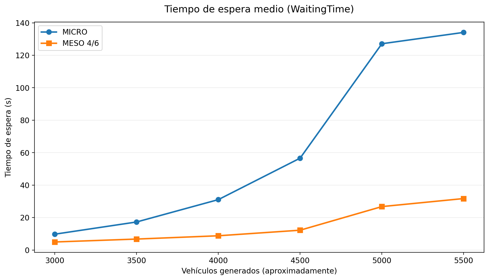

MICRO registra un tiempo de espera medio mayor, especialmente cuando la demanda alcanza los 5000 y 5500 vehículos. Es una de las principales diferencias entre los modelos.

### Duración media de los recorridos

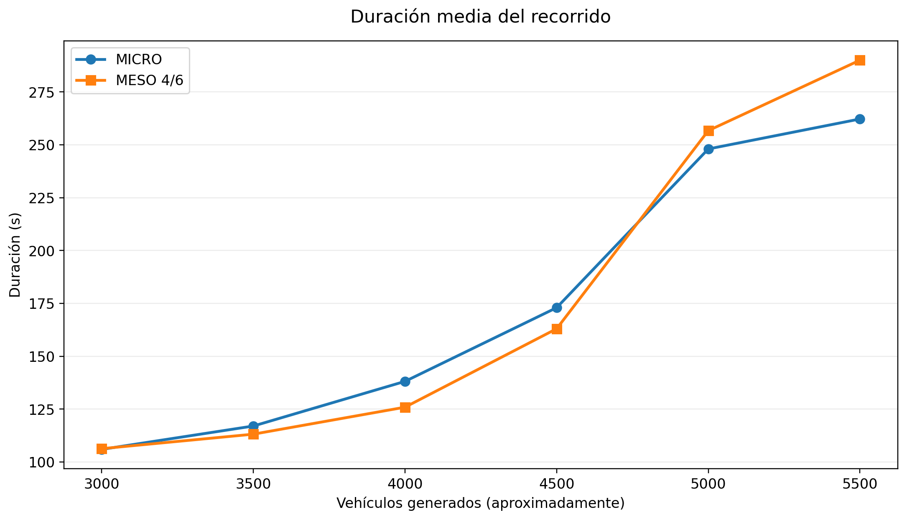

La duración media aumenta con la congestión. Los dos modelos muestran una tendencia parecida, aunque MESO presenta diferencias en los escenarios más saturados.

### Retraso de incorporación (DepartDelay)

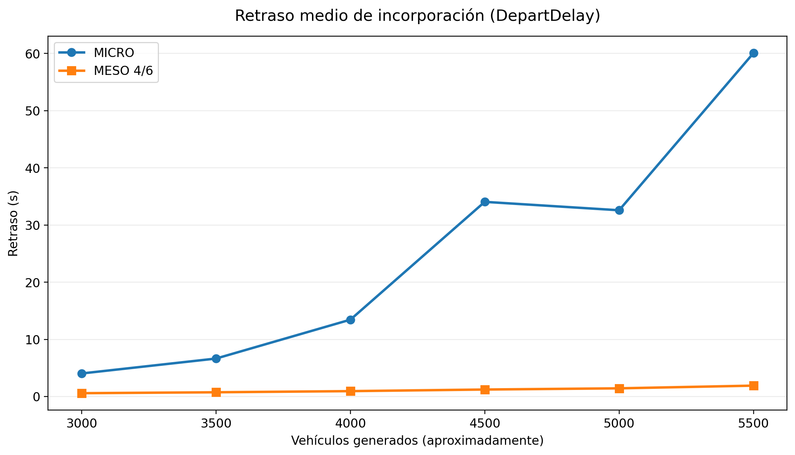

El retraso medio de incorporación de los vehículos finalizados es considerablemente mayor en MICRO, sobre todo con demandas elevadas.

### Longitud media de los recorridos

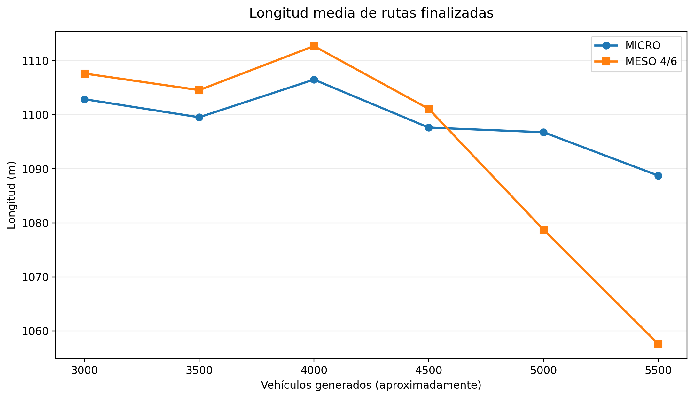

La longitud media de las rutas completadas es similar en ambos modelos. Las diferencias se deben, en parte, a que no siempre finalizan los mismos vehículos antes del segundo 3600.

### Vehículos insertados

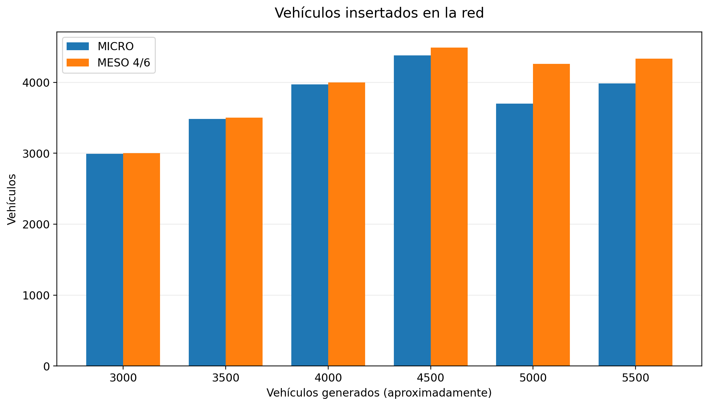

En los escenarios con mayor demanda, MESO consigue insertar más vehículos que MICRO, aunque también se acumulan vehículos pendientes de entrar.

### Vehículos finalizados

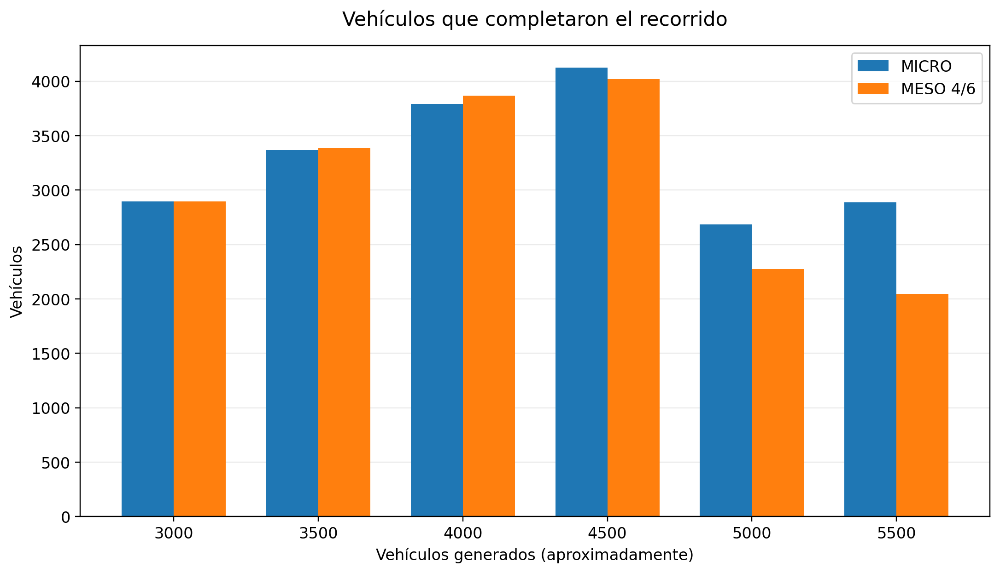

Hasta 4500 vehículos, las cantidades de viajes finalizados son relativamente próximas. Con 5000 y 5500 vehículos aparecen diferencias mayores.

### Vehículos pendientes de entrar

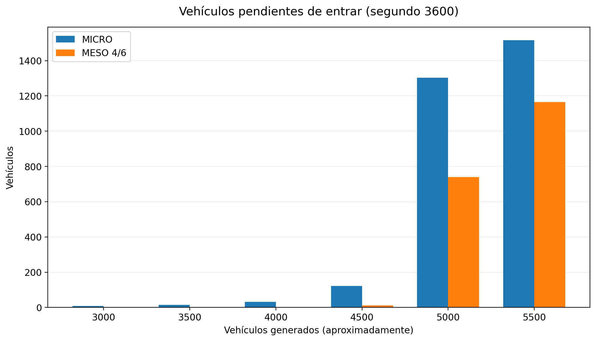

Al aumentar la congestión, crece el número de vehículos que no han conseguido incorporarse a la red al terminar la hora simulada.

### Teletransportes

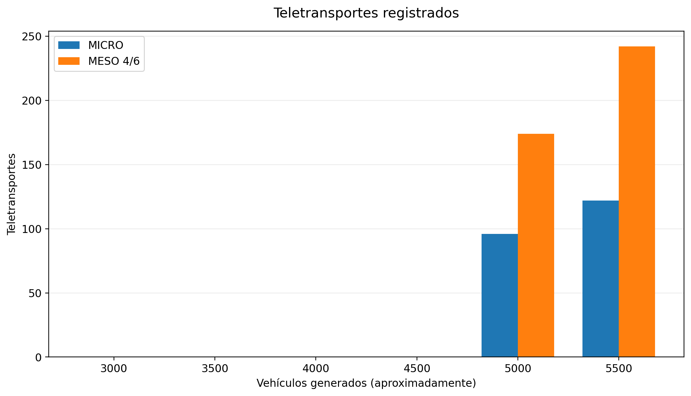

Entre 3000 y 4500 vehículos no se registran teletransportes. En las demandas de 5000 y 5500 aparecen en ambos modelos y son más numerosos en MESO 4/6.

### Tiempo real de ejecución

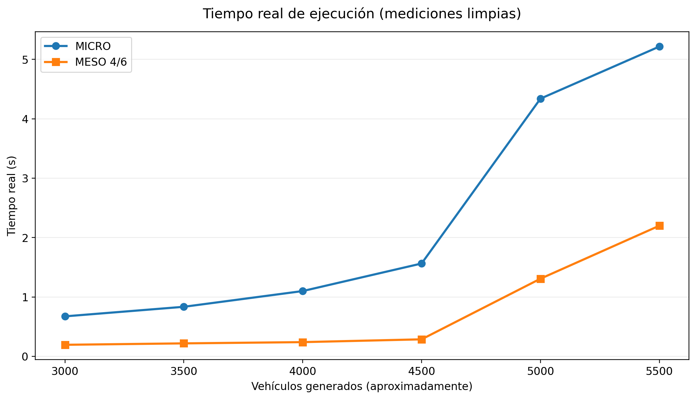

MESO requiere menos tiempo real de ejecución que MICRO, especialmente con las demandas más elevadas. Esta gráfica utiliza las **mediciones limpias** de los dos modelos.

### Aceleración de MESO respecto a MICRO

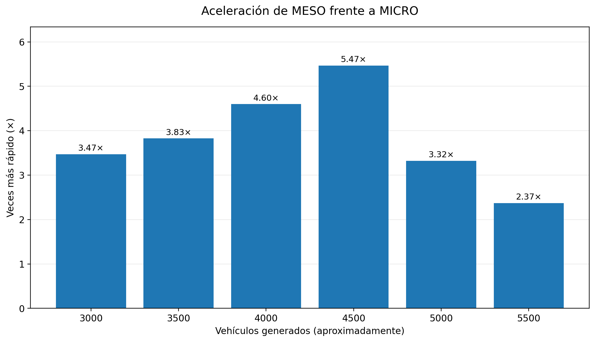

La aceleración se calcula dividiendo el tiempo real de ejecución de MICRO entre el de MESO. Indica cuántas veces más rápido se ha ejecutado MESO en cada escenario. Los valores proceden de mediciones individuales, no de promedios de múltiples repeticiones.

### Porcentaje de vehículos finalizados

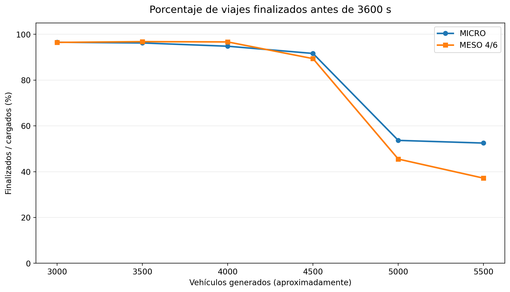

La gráfica representa el porcentaje de vehículos cargados que finalizan antes del segundo 3600. Con demandas elevadas este porcentaje disminuye, lo que permite observar la saturación de la red.

### Influencia de `tauff` sobre el TimeLoss

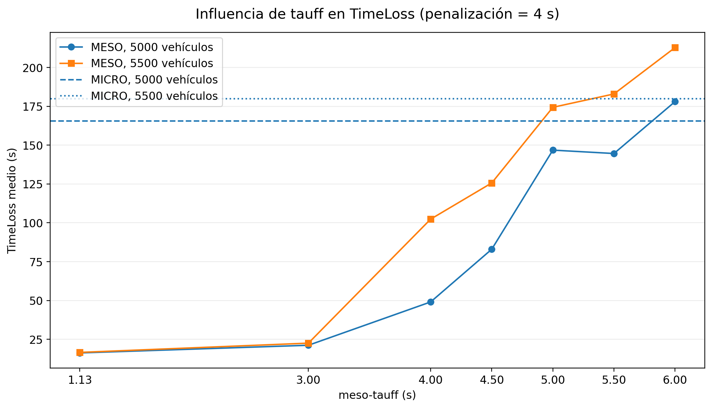

Esta gráfica corresponde a la primera prueba de calibración, con una penalización fija de 4 segundos. Muestra cómo cambia el `TimeLoss` de MESO al aumentar `tauff` y permite compararlo con las referencias microscópicas de 5000 y 5500 vehículos.

Se observa que `tauff` puede utilizarse para modificar la capacidad de transferencia entre segmentos libres y, con ello, influir en la congestión de la red.

### Observación general

Las gráficas muestran que la configuración MESO 4/6 aproxima varias estadísticas de MICRO, especialmente la velocidad y la duración media de los recorridos. Sin embargo, existen diferencias importantes en los tiempos de espera, los vehículos finalizados y los teletransportes cuando la red está muy congestionada. Su principal ventaja es el menor tiempo de ejecución.
