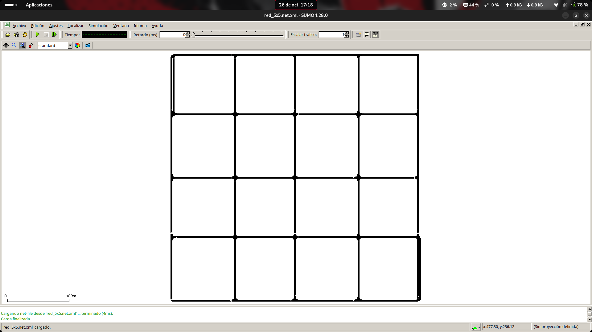

# Generación de mapa sintético en SUMO

## Descripción

El script `mapa_sintetico.py` permite generar una red de carreteras en forma de cuadrícula NxN, donde se puede elegir el número de intersecciones, la distancia entre ellas y la semilla aleatoria.

## Comando utilizado

```bash
python3 mapa_sintetico.py -n 5 --longitud 100 --semilla 42
```

**Parámetros:**
- `-n 5`: genera una red de 5×5 intersecciones.
- `--longitud 100`: distancia de 100 metros entre intersecciones.
- `--semilla 42`: permite generar la misma red utilizando los mismos parámetros.

## Visualización en SUMO

Para abrir la red generada:

```bash
sumo-gui -n red_5x5/red_5x5.net.xml
```

Este comando abre SUMO-GUI y carga la red de carreteras generada, permitiendo visualizar las intersecciones y sus conexiones.

## Resultado

Red sintética de **25 intersecciones y 16 manzanas**, visualizada en SUMO-GUI.



---

# Simulación microscópica

Una vez generada la red, se realizan simulaciones microscópicas con diferentes cantidades de vehículos para observar cómo se comporta el tráfico.

Todas las simulaciones tienen una duración de **3.600 segundos (1 hora)**.

## Generación de tráfico

Para generar los vehículos se utiliza `randomTrips.py`, una herramienta de SUMO que crea viajes aleatorios dentro de la red.

Como ejemplo, se generan aproximadamente **1.000 vehículos durante una hora simulada**.

Primero se crea una carpeta para guardar los archivos:

```bash
mkdir -p red_5x5/1000_rutas
```

Después se generan los viajes y sus rutas:

```bash
python3 /usr/share/sumo/tools/randomTrips.py \
  -n red_5x5/red_5x5.net.xml \
  -b 0 \
  -e 3600 \
  -p 3.6 \
  --random-depart \
  --seed 42 \
  -o red_5x5/1000_rutas/trips_1000.trips.xml \
  -r red_5x5/1000_rutas/rutas_1000.rou.xml
```

Este comando genera los vehículos y les asigna rutas y tiempos de salida aleatorios.

**Parámetros principales:**

- `-n`: indica la red de carreteras que se utilizará.
- `-b 0` y `-e 3600`: establecen el periodo de generación de los vehículos.
- `-p 3.6`: indica el intervalo de generación para obtener aproximadamente 1.000 vehículos.
- `--random-depart`: distribuye aleatoriamente los tiempos de salida.
- `--seed 42`: permite repetir la generación con los mismos parámetros.
- `-o`: guarda los viajes generados.
- `-r`: guarda las rutas que utilizará SUMO.

Para generar otras cantidades de vehículos, basta con cambiar el parámetro `-p` y los nombres de los archivos correspondientes.

## Visualización de la simulación

Una vez generadas las rutas, se utiliza SUMO-GUI para ver cómo circulan los vehículos.

```bash
sumo-gui \
  -n red_5x5/red_5x5.net.xml \
  -r red_5x5/1000_rutas/rutas_1000.rou.xml \
  --begin 0 \
  --end 3600 \
  --delay 20
```

Este comando carga la red y los vehículos generados para realizar una simulación de una hora.

- `-n`: carga la red de carreteras.
- `-r`: carga las rutas de los vehículos.
- `--begin` y `--end`: indican cuándo empieza y termina la simulación.
- `--delay 20`: añade un pequeño retardo para facilitar la visualización.

Con SUMO-GUI se puede observar el movimiento de los vehículos y comprobar si se forman colas o atascos en las intersecciones.

## Medición del rendimiento

Para medir cuánto tarda en ejecutarse la simulación y obtener estadísticas, se utiliza SUMO sin interfaz gráfica.

```bash
time sumo \
  -n red_5x5/red_5x5.net.xml \
  -r red_5x5/1000_rutas/rutas_1000.rou.xml \
  --begin 0 \
  --end 3600 \
  --duration-log.statistics \
  --statistic-output red_5x5/1000_rutas/micro_1000_stats.xml \
  --log red_5x5/1000_rutas/micro_1000.log
```

Este comando ejecuta la simulación y muestra información sobre el tráfico y el tiempo que ha tardado en completarse.

- `time`: mide el tiempo real de ejecución.
- `--duration-log.statistics`: muestra las estadísticas al finalizar la simulación.
- `--statistic-output`: guarda las estadísticas en un archivo XML.
- `--log`: guarda el registro de ejecución y los posibles avisos.

Entre los resultados obtenidos se encuentran los vehículos que han entrado en la red, los que han terminado sus recorridos, los que siguen esperando, los tiempos de viaje y los posibles teletransportes.

Los resultados se guardan en sus respectivas carpetas para poder consultarlos y compararlos.

## Seguimiento del tráfico

También se puede guardar información del tráfico cada cierto tiempo para ver cómo evoluciona durante la simulación.

```bash
sumo \
  -n red_5x5/red_5x5.net.xml \
  -r red_5x5/1000_rutas/rutas_1000.rou.xml \
  --begin 0 \
  --end 3600 \
  --summary-output red_5x5/1000_rutas/micro_1000_summary.xml \
  --summary-output.period 60 \
  --no-step-log
```

Este comando guarda estadísticas cada **60 segundos simulados**, permitiendo comprobar cuántos vehículos están circulando, cuántos esperan para entrar y cómo cambia la congestión durante la hora.

---

## Resultados de las simulaciones microscópicas

Se han realizado varias pruebas aumentando la cantidad de vehículos desde 500 hasta 3.500, utilizando siempre la misma red y una duración de 3.600 segundos.

Las pruebas se han realizado con **SUMO 1.28.0**.

### Tabla comparativa

| Vehículos | Insertados | Finalizados | Waiting | Espera media (s) | Viaje medio (s) | Velocidad (m/s) | Teletransportes | Tiempo real (s) |
|---|---:|---:|---:|---:|---:|---:|---:|---:|
| 500 | 501 | 493 | 0 | 0,16 | 53,71 | 10,94 | 0 | 0,151 |
| 1.000 | 1.001 | 981 | 0 | 0,59 | 54,84 | 10,70 | 0 | 0,220 |
| 1.500 | 1.500 | 1.471 | 0 | 1,56 | 56,95 | 10,37 | 0 | 0,327 |
| 2.000 | 2.000 | 1.956 | 0 | 3,97 | 60,84 | 9,83 | 0 | 0,432 |
| 2.500 | 2.500 | 2.442 | 0 | **9,55** | 70,64 | 8,95 | 0 | 0,577 |
| **3.000** | 2.970 | 2.817 | **31** | **33,45** | **107,26** | 7,07 | 0 | 0,911 |
| **3.500** | **1.105** | **597** | **2.395** | **323,41** | **430,00** | **6,25** | **127** | **5,826** |

**Significado de los resultados:**

- **Insertados:** vehículos que han conseguido entrar en la red.
- **Finalizados:** vehículos que han terminado sus recorridos.
- **Waiting:** vehículos que siguen esperando para incorporarse al finalizar la simulación.
- **Espera media:** tiempo medio que los vehículos han pasado detenidos durante sus recorridos.
- **Viaje medio:** tiempo medio necesario para completar los recorridos.
- **Velocidad:** velocidad media registrada para los viajes completados.
- **Teletransportes:** veces que SUMO ha tenido que intervenir para resolver bloqueos prolongados.
- **Tiempo real:** tiempo que ha tardado el ordenador en ejecutar la simulación.

Los tiempos medios se calculan sobre los vehículos que han completado sus recorridos.

### Observaciones

- **De 500 a 2.500 vehículos:** la red permite incorporar todos los vehículos, aunque los tiempos de espera van aumentando.
- **Con 3.000 vehículos:** la congestión aumenta considerablemente y aparecen los primeros vehículos pendientes de incorporarse.
- **Con 3.500 vehículos:** se observa una saturación mucho mayor, con **2.395 vehículos esperando** y **127 teletransportes**.

También se observa un aumento importante del tiempo de ejecución, pasando de **0,911 s a 5,826 s** entre las dos últimas pruebas.
